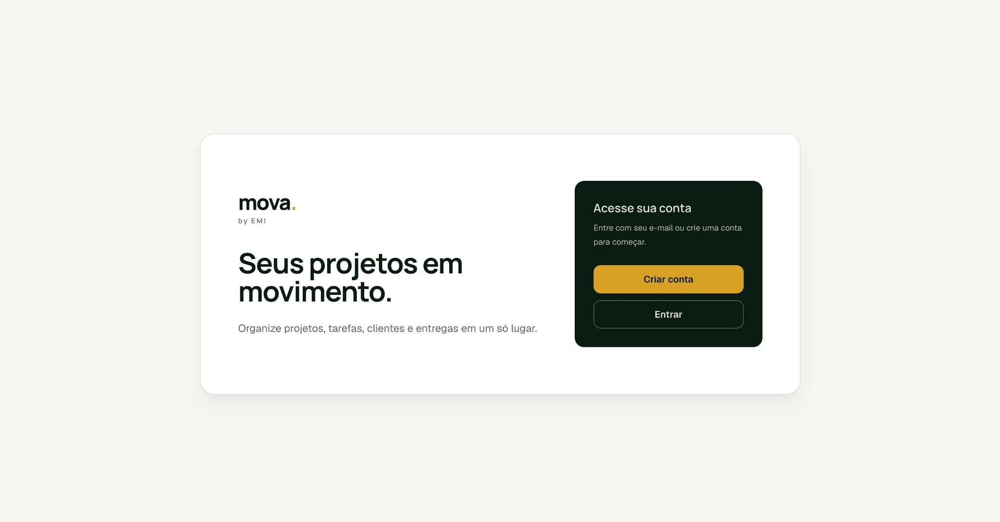
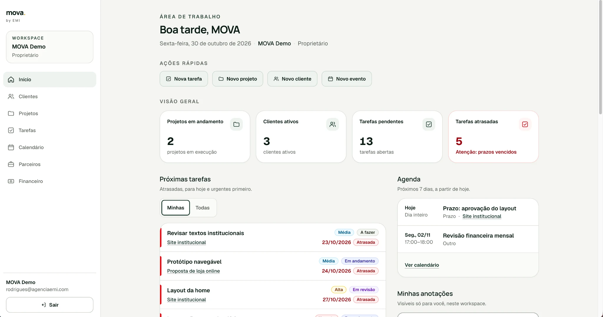
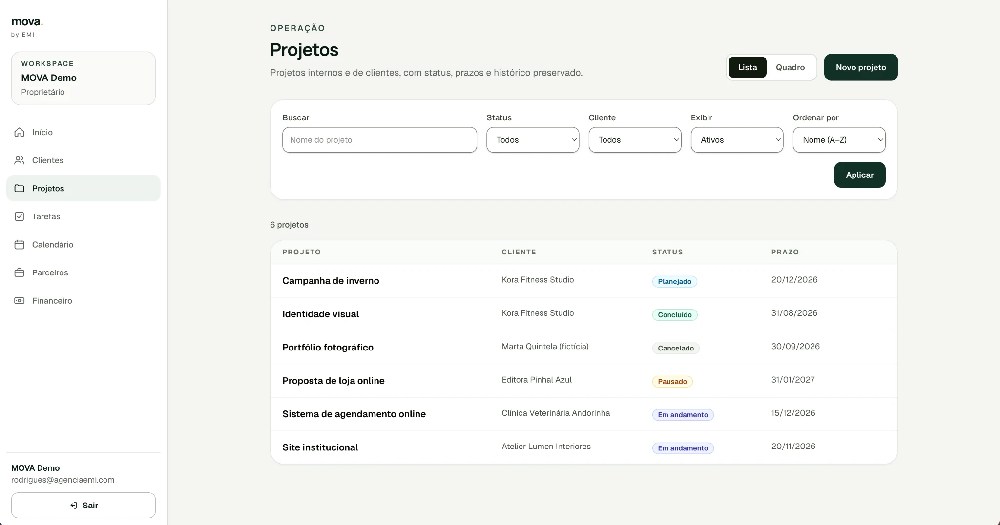
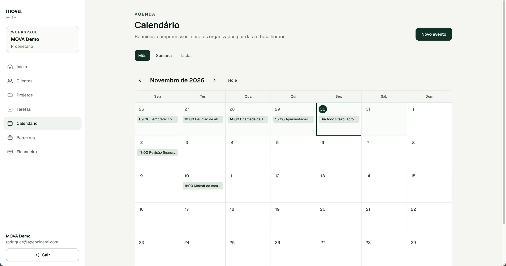

<div align="center">

[🇺🇸 English](./README.md) · **🇧🇷 Português** · [🇪🇸 Español](./README.es.md)

# mova.

### Seus projetos em movimento.

**Uma plataforma full-stack para clientes, projetos, tarefas, calendário, parceiros e finanças.**

Case de engenharia de produto por **Marcus Castro** · MOVA, by EMI

[Conhecer o produto](#o-produto) · [Decisões técnicas](#decisões-de-engenharia) · [Demo privada](https://mova.agenciaemi.com)

**Next.js 16 · React 19 · TypeScript · Supabase · PostgreSQL · Tailwind CSS 4**

</div>

> **Case de portfólio, não aplicação open source.** O código de produção permanece privado. Este repositório documenta o produto e sua arquitetura sem expor código proprietário, credenciais ou dados de clientes. A demonstração exige acesso autorizado.

## O problema

Profissionais autônomos e pequenas equipes criativas frequentemente organizam clientes, projetos, prazos, parceiros e finanças em ferramentas separadas. Isso dificulta conectar entregas, tarefas e pagamentos.

**O MOVA reúne essas atividades em um mesmo workspace**, voltado à operação diária de negócios de serviços.

## O produto

| Área | Experiência |
| --- | --- |
| **Dashboard** | Projetos, clientes, tarefas pendentes e atrasadas, agenda e anotações |
| **Clientes** | Cadastros, status, busca e projetos relacionados |
| **Projetos** | Prazos, clientes, filtros, status e visualizações em lista/quadro |
| **Tarefas** | Kanban, prioridades, responsáveis e andamento |
| **Calendário** | Visualizações mensal, semanal e lista, eventos e fusos horários |
| **Parceiros** | Colaboradores externos vinculados aos projetos |
| **Financeiro** | Contas a receber/pagar, pagamentos parciais, estornos e histórico |

## Galeria de interfaces

### 01 — Acesso e cadastro

Uma tela de entrada que apresenta a proposta do produto e as opções de autenticação.



### 02 — Dashboard do workspace

Indicadores, tarefas priorizadas, agenda e ações rápidas.



### 03 — Gestão de projetos

Busca e filtros de cliente, status e ordenação para a operação diária.



### 04 — Calendário

Visão mensal de eventos e prazos, com alternativas semanal e em lista.



## Decisões de design

- Hierarquia visual: indicadores e ações imediatas acima dos detalhes.
- Navegação consistente: menu persistente para as áreas do workspace.
- Ações rápidas: criação de tarefas, projetos, clientes e eventos.
- Estados claros: tarefas atrasadas com ênfase visual e rótulos além da cor.
- Contexto: identificação visível do workspace e do papel do usuário.

## Destaques técnicos

- **Arquitetura multi-tenant:** workspaces, membros e autorização por escopo.
- **Segurança no banco:** Supabase Auth, PostgreSQL Row Level Security (RLS), funções e validações de servidor.
- **Financeiro:** liquidações parciais, histórico, estornos e proteções contra duplicação.
- **Datas:** distinção entre prazos, eventos com horário e eventos de dia inteiro, respeitando o fuso do workspace.
- **Publicação:** Docker multi-stage, servidor Next.js standalone e Render.
- **Testes:** TypeScript, testes unitários, Playwright e pgTAP.

## Tecnologias

| Camada | Stack |
| --- | --- |
| Frontend | Next.js 16, React 19, TypeScript, Tailwind CSS 4 |
| Backend | App Router, Server Components, Server Actions, Supabase |
| Banco | PostgreSQL 17, migrations SQL, RLS, RPCs e triggers |
| Autenticação | Supabase Auth e barreira HTTP Basic na demo |
| Qualidade | Playwright, testes unitários, pgTAP |
| Entrega | GitHub, Docker, Render |

## Arquitetura

```text
Navegador → Render HTTPS + controle HTTP Basic
          → Next.js (App Router, componentes e ações de servidor)
          → Sessão Supabase Auth
          → PostgreSQL / RLS / funções
          → Dados restritos a cada workspace
```

A autorização é aplicada também no banco de dados, independentemente da visibilidade dos controles na interface.

## Decisões de engenharia

**01 — Isolamento de dados:** papéis e vínculos determinam permissões, com RLS e checagens no servidor.

**02 — Histórico financeiro:** liquidações parciais, estornos e transições preservam eventos anteriores em vez de apenas sobrescrever o saldo.

**03 — Datas corretas:** prazos, reuniões e eventos de dia inteiro exigem tratamento diferente para evitar problemas com fusos.

**04 — Demonstração privada:** ambiente dedicado, dados fictícios, acesso HTTP Basic e autenticação da aplicação.

## Demonstração

**[mova.agenciaemi.com](https://mova.agenciaemi.com)** · Acesso privado mediante solicitação.

É um protótipo ativo, não um SaaS lançado publicamente.

## Documentação

- [Arquitetura](docs/architecture.md)
- [Funcionalidades](docs/features.md)
- [Notas de engenharia](docs/engineering.md)
- [Roadmap](docs/roadmap.md)
- [Galeria](screenshots/README.md)

## Minha atuação

Requisitos de produto, UX/UI, implementação full-stack, modelagem de dados, autorização, testes, deploy e documentação.

## Situação e próximos passos

A demonstração privada inclui dashboard, clientes, projetos, tarefas, calendário, parceiros e financeiro. Próximos passos: colaboração, onboarding, relatórios e amadurecimento para produção.

---

**[Marcus Castro](https://github.com/marcuscastrodev)** · Desenvolvimento web e engenharia de produto
