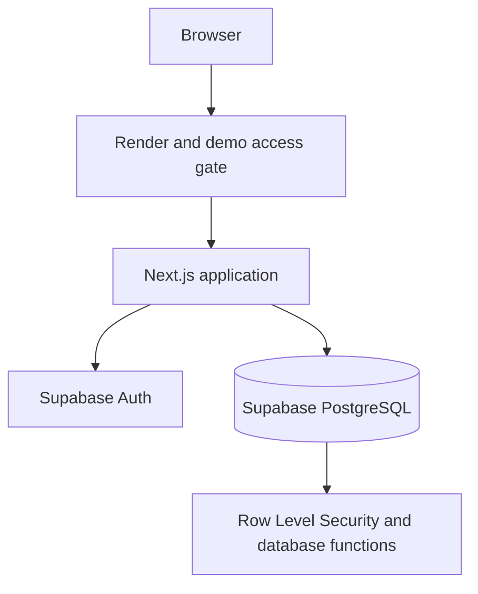

# MOVA architecture

> Public technical overview. The production source code and infrastructure credentials remain private.

## System overview

MOVA is a workspace-based SaaS prototype built with **Next.js 16**, **React 19**, **TypeScript**, **Tailwind CSS 4**, and **Supabase (PostgreSQL 17)**. It is packaged as a standalone Node.js application in Docker and deployed through Render.

## Main layers

**Presentation:** responsive pages for dashboard, clients, projects, tasks, calendar, partners, and finances.

**Application:** authenticated server-side actions and business workflows using Next.js App Router.

**Persistence:** PostgreSQL tables, relational constraints, migrations, SQL functions, and RLS policies managed through Supabase.

**Deployment:** Docker multi-stage build and Next.js standalone server running on Render, with secrets supplied as environment variables rather than source files.

## Workspace isolation

The data model supports workspaces, membership, and roles. Server-side authorization and PostgreSQL RLS are used together: access is not controlled only by whether a button or route is visible in the UI.

## Financial data integrity

MOVA models financial entries separately from settlement movements. This allows partially paid amounts, reversals, cancellation history, and calculated pending balances without erasing the underlying audit trail.

## Dates and time zones

The calendar handles scheduled events, cancellation, and workspace-aware time zones. Date-only and timestamp-based values have different meanings and are treated accordingly.

## Demo security boundary

The public project documentation does **not** contain private source code, API keys, service-role tokens, internal credentials, SQL policies, or environment files. The deployed demo requires an additional access gate plus application authentication.

## Testing

The project has undergone automated checks, including type validation, unit-level verification, database-focused tests, and Playwright end-to-end flows. The exact test suite, private configuration, and deployment scripts are not part of this public showcase.

[← Back to overview](../README.md)
